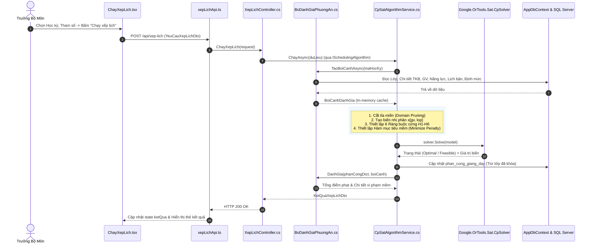

# TÀI LIỆU TOÀN DIỆN VỀ KIẾN TRÚC, NGHIỆP VỤ & MÃ NGUỒN DỰ ÁN XẾP LỊCH GIẢNG DẠY (SV2)

> **Mục đích tài liệu:** Giúp bạn nắm bắt 100% dự án, tự tin giải thích từng dòng code thực thi nghiệp vụ, hiểu rõ luồng biến đổi dữ liệu giữa các file, nắm các lưu ý kỹ thuật then chốt và các điểm cải tiến có lợi khi bảo vệ trước Giảng viên hướng dẫn (GVHD).

---

## MỤC LỤC
1. [Kiến Trúc Tổng Thể & Triết Lý Thiết Kế](#1-kiến-trúc-tổng-thể--triết-lý-thiết-kế)
2. [Mô Hình Dữ Liệu & Bản Đồ Quan Hệ (Database & Entities)](#2-mô-hình-dữ-liệu--bản-đồ-quan-hệ-database--entities)
3. [Phân Tích Chi Tiết 3 Luồng Nghiệp Vụ Cốt Lõi](#3-phân-tích-chi-tiết-3-luồng-nghiệp-vụ-cốt-lõi)
   - [Luồng 1: Chạy Xếp Lịch Tự Động Bằng CP-SAT (Google OR-Tools)](#luồng-1-chạy-xếp-lịch-tự-động-bằng-cp-sat-google-or-tools)
   - [Luồng 2: Hiển Thị Kết Quả, Duyệt & Can Thiệp Phân Công Thủ Công](#luồng-2-hiển-thị-kết-quả-duyệt--can-thiệp-phân-công-thủ-công)
   - [Luồng 3: Quản Lý Nguyện Vọng, Lịch Bận & Năng Lực Giảng Dạy](#luồng-3-quản-lý-nguyện-vọng-lịch-bận--năng-lực-giảng-dạy)
4. [Mổ Xẻ Từng Đoạn Code Trọng Tâm (Code Deep-Dive)](#4-mổ-xẻ-từng-đoạn-code-trọng-tâm-code-deep-dive)
   - [CpSatAlgorithmService.cs: Trái tim thuật toán](#41-cpsatalgorithmservicecs--trái-tim-thuật-toán)
   - [BoDanhGiaPhuongAn.cs: Đánh giá ràng buộc mềm & Fitness](#42-bodanhgiaphuongancs--đánh-giá-ràng-buộc-mềm--fitness)
   - [BoKiemTraRangBuoc.cs: Bộ lọc xung đột thời gian](#43-bokiemtrarangbuoccs--bộ-lọc-xung-đột-thời-gian)
   - [XepLichService.cs: Can thiệp thủ công & Xuất Excel](#44-xeplichservicecs--can-thiệp-thủ-công--xuất-excel)
   - [KetQuaXepLich.tsx & ChayXepLich.tsx: Xử lý giao diện](#45-frontend-ketquaxeplichtsx--chayxeplichtsx)
5. [Các Lưu Ý Kỹ Thuật, Điểm Thay Thế & Nâng Cấp Có Lợi](#5-các-lưu-ý-kỹ-thuật-điểm-thay-thế--nâng-cấp-có-lợi)
6. [Bộ Câu Hỏi & Trả Lời Mẫu Khi Bảo Vệ Đồ Án](#6-bộ-câu-hỏi--trả-lời-mẫu-khi-bảo-vệ-đồ-án)

---

## 1. KIẾN TRÚC TỔNG THỂ & TRIẾT LÝ THIẾT KẾ

### 1.1. Sơ đồ phân tầng (3-Tier Layered Architecture)
Hệ thống tuân thủ nghiêm ngặt mô hình 3 tầng tinh gọn, loại bỏ các lớp trung gian không cần thiết (không dùng Generic Repository, không UnitOfWork cồng kềnh):

```text
┌────────────────────────────────────────────────────────┐
│                   CLIENT (FRONTEND)                    │
│      React 19 + TypeScript + Vite + Bootstrap 5        │
│    - ChayXepLich.tsx    - KetQuaXepLich.tsx            │
│    - DanhSachNguyenVong - DanhSachGiangVien            │
└──────────────────────────┬─────────────────────────────┘
                           │ (HTTP REST API qua Axios)
                           ▼
┌────────────────────────────────────────────────────────┐
│                   TẦNG 1: CONTROLLER                   │
│   [ApiController] tiếp nhận Request, Validate DTO      │
│   - XepLichController.cs   - NguyenVongController.cs   │
│   - GiangVienController.cs - HocPhanController.cs      │
└──────────────────────────┬─────────────────────────────┘
                           │ (Gọi hàm Service nghiệp vụ)
                           ▼
┌────────────────────────────────────────────────────────┐
│                   TẦNG 2: SERVICE LAYER                │
│   Chứa toàn bộ nghiệp vụ, giải thuật toán học & kiểm tra │
│   - CpSatAlgorithmService  - BoDanhGiaPhuongAn        │
│   - BoKiemTraRangBuoc      - XepLichService           │
│   - NguyenVongService      - GiangVienService         │
└──────────────────────────┬─────────────────────────────┘
                           │ (LINQ truy vấn DbContext)
                           ▼
┌────────────────────────────────────────────────────────┐
│                   TẦNG 3: DATA ACCESS                  │
│       AppDbContext (Entity Framework Core 8)           │
│       Cấu hình quan hệ, khóa chính/ngoại, snake_case   │
└──────────────────────────┬─────────────────────────────┘
                           │ (T-SQL queries)
                           ▼
┌────────────────────────────────────────────────────────┐
│                   DATABASE (SQL SERVER)                │
│       Cơ sở dữ liệu XepLichGiangDay                    │
└────────────────────────────────────────────────────────┘
```

### 1.2. Tại sao chọn kiến trúc này?
1. **Dễ giải thích với GVHD:** Luồng đi thẳng 1 chiều: `Controller -> Service -> AppDbContext -> SQL Server`. Không có các interface vô hình làm rối code.
2. **Hiệu năng cao:** Tận dụng trực tiếp khả năng AsNoTracking, Bulk Query và LINQ của Entity Framework Core.
3. **Phân định rõ ràng trách nhiệm:**
   - SV1: Import Excel, năm học, học kỳ, bộ môn, tài khoản, giải thuật GA.
   - SV2 (Phạm vi của bạn): Quản lý giảng viên, năng lực môn học, lịch bận, nguyện vọng mềm, giải thuật CP-SAT (Google OR-Tools), bộ tính điểm phạt, duyệt can thiệp thủ công và xuất báo cáo Excel.

---

## 2. MÔ HÌNH DỮ LIỆU & BẢN ĐỒ QUAN HỆ (DATABASE & ENTITIES)

Toàn bộ Entity nằm tại `backend/XepLichGiangDay.Api/Models/Entities/` và được ánh xạ trong `AppDbContext.cs`:

### 2.1. Nhóm Dữ liệu Đào tạo & Thời khóa biểu (Đầu vào cố định sau Import)
* **`hoc_ky` (`HocKy.cs`):** Quản lý học kỳ áp dụng (vd: Học kỳ 1, năm học 2024-2025). Khóa chính: `MaHocKy`.
* **`hoc_phan` (`HocPhan.cs`):** Danh mục môn học (Mã HP, Tên HP, Số tín chỉ, Loại môn).
* **`lop_hoc_phan` (`LopHocPhan.cs`):** Lớp mở trong kỳ (Mã lớp trường như `241_71ITEC20101`, Tên lớp `ITEC01`, Sĩ số).
* **`chi_tiet_thoi_khoa_bieu` (`ChiTietThoiKhoaBieu.cs`):** Lịch học cố định của lớp (Thứ, Tiết bắt đầu, Tiết kết thúc, Phòng học, Từ tuần, Đến tuần). Quan hệ 1 Lớp HP có thể có nhiều buổi học.

### 2.2. Nhóm Giảng viên & Năng lực, Nguyện vọng (Phạm vi SV2)
* **`giang_vien` (`GiangVien.cs`):** Thông tin giảng viên (Họ tên, Email, Chức danh `Cơ hữu`/`Thỉnh giảng`, Trạng thái).
* **`nang_luc_giang_day` (`NangLucGiangDay.cs`):** Bảng N-N giữa Giảng viên và Học phần. Một GV chỉ được phân dạy môn mà họ có năng lực (Ràng buộc cứng H2).
* **`lich_ban_giang_vien` (`LichBanGiangVien.cs`):** Lịch bận cố định không thể dạy (Thứ, Tiết BĐ - Tiết KT). Thuật toán không bao giờ được xếp vào đây (Ràng buộc cứng H3).
* **`nguyen_vong_giang_vien` (`NguyenVongGiangVien.cs`):** Nguyện vọng mềm (Tránh ca tối SC02, Tránh cuối tuần SC03, Thích ca sáng SC04, Thích ca chiều SC05, Hạn chế số ngày dạy SC07...). Vi phạm sẽ bị tính điểm phạt mềm.
* **`dinh_muc_giang_vien` (`DinhMucGiangVien.cs`):** Định mức số tiết tối thiểu (`SoTietToiThieu`) và tối đa (`SoTietToiDa`) mỗi tuần.

### 2.3. Nhóm Kết quả Phân công
* **`phan_cong_giang_day` (`PhanCongGiangDay.cs`):** Kết quả phân công thực tế giữa Lớp học phần và Giảng viên:
  - `TrangThai`: `DuKien` (do thuật toán xếp) hoặc `DaKhoa` (do Trưởng bộ môn ghim thủ công).
  - `NguonPhanCong`: `CP_SAT`, `GA`, hoặc `ThuCong`.
* **`ket_qua_xep_lich` (`KetQuaXepLich.cs`):** Lưu điểm phạt và đánh giá tổng thể của đợt chạy xếp lịch.

---

## 3. PHÂN TÍCH CHI TIẾT 3 LUỒNG NGHIỆP VỤ CỐT LÕI

### Luồng 1: Chạy Xếp Lịch Tự Động Bằng CP-SAT (Google OR-Tools)



---

### Luồng 2: Hiển Thị Kết Quả, Duyệt & Can Thiệp Phân Công Thủ Công

```mermaid
sequenceDiagram
    autonumber
    actor User as Trưởng Bộ Môn
    participant UI as KetQuaXepLich.tsx
    participant Ctrl as XepLichController.cs
    participant Svc as XepLichService.cs
    participant Checker as BoKiemTraRangBuoc.cs
    participant DB as SQL Server

    User->>UI: Xem Bảng phân công / Thống kê tải / Ma trận TKB
    UI->>Ctrl: GET /api/xep-lich/bang-phan-cong/{maHocKy}
    Ctrl->>Svc: LayBangPhanCongAsync(maHocKy)
    Svc-->>Ctrl-->>UI: BangPhanCongHocKyDto (kèm danh sách ứng viên hợp lệ/vi phạm)

    opt Can thiệp đổi Giảng viên bằng tay
        User->>UI: Chọn GV khác cho Lớp HP
        UI->>Ctrl: POST /api/xep-lich/phan-cong-thu-cong
        Ctrl->>Svc: PhanCongThuCongAsync(req)
        Svc->>Checker: Kiểm tra Chuyên môn, Trùng lịch dạy, Lịch bận
        alt Có vi phạm & Chưa chọn bỏ qua cảnh báo
            Checker-->>Svc: Có lỗi vi phạm
            Svc-->>Ctrl-->>UI: canXacNhan = true, danhSachViPham
            UI->>User: Mở Modal cảnh báo vi phạm xung đột!
        else Hợp lệ hoặc Xác nhận ghi đè
            Svc->>DB: Cập nhật phan_cong_giang_day (Nguon: ThuCong)
            Svc-->>Ctrl-->>UI: Thành công -> Tải lại bảng phân công
        end
    end

    opt Khóa / Ghim lớp cố định
        User->>UI: Bấm nút "Khóa"
        UI->>Ctrl: PUT /api/xep-lich/khoa/{maLopHocPhan}?daKhoa=true
        Ctrl->>Svc: DoiTrangThaiKhoaAsync(maLopHocPhan, true)
        Svc->>DB: phan_cong.TrangThai = 'DaKhoa'
        Svc-->>UI: Đã khóa (Lần sau thuật toán giữ nguyên)
    end
```

---

### Luồng 3: Quản Lý Nguyện Vọng, Lịch Bận & Năng Lực Giảng Dạy

* **Giảng viên:** Truy cập `/nguyen-vong`, chọn mã ràng buộc (SC01: Tránh giờ, SC02: Tránh tối, SC04: Thích sáng...), nhập lý do, gửi lên hệ thống.
* **Trưởng bộ môn:** Xem danh sách nguyện vọng tập trung của toàn bộ giảng viên trong kỳ. Có thể khai báo hộ giảng viên nếu cần.
* **Xử lý lưu trữ:** `NguyenVongController.cs` $\rightarrow$ `NguyenVongService.cs` $\rightarrow$ Lưu vào bảng `nguyen_vong_giang_vien`. Trọng số phạt mặc định từ 5.0 - 15.0 được gán tương ứng để đưa vào bài toán tối ưu.

---

## 4. MỔ XẺ TỪNG ĐOẠN CODE TRỌNG TÂM (CODE DEEP-DIVE)

### 4.1. `CpSatAlgorithmService.cs` — Trái Tim Thuật Toán

#### Kỹ thuật 1: Domain Pruning (Cắt tỉa miền trước khi sinh biến)
Thay vì sinh biến cho toàn bộ $M \times N$ cặp (Giảng viên $\times$ Lớp học phần), code lọc trước ứng viên hợp lệ:

```csharp
// CpSatAlgorithmService.cs (dòng 73 - 91)
foreach (var gv in boiCanh.GiangVienTheoMa.Values)
{
    int maGv = gv.MaGiangVien;

    // H2: Phải có đúng chuyên môn giảng dạy học phần này
    bool coChuyenMon = boiCanh.NangLucTheoGv.TryGetValue(maGv, out var setHp) && setHp.Contains(lop.MaHocPhan);
    if (!coChuyenMon) continue; // CẮT BỎ NGAY, KHÔNG SINH BIẾN

    // H3: Không được vướng lịch bận cố định đã đăng ký
    var dsLb = boiCanh.LichBanTheoGv.GetValueOrDefault(maGv) ?? [];
    bool vuongLichBan = dsBuoiHoc.Any(ct => boKiemTra.CoVuongLichBan(maGv, ct.Thu, ct.TietBatDau, ct.TietKetThuc, dsLb));
    if (vuongLichBan) continue; // CẮT BỎ NGAY, KHÔNG SINH BIẾN

    // Chỉ sinh biến nhị phân khi thỏa mãn đồng thời H2 & H3
    var xVar = model.NewBoolVar($"x_g{maGv}_l{maLop}");
    xVars[(maGv, maLop)] = xVar;
}
```
> **Ý nghĩa:** Nếu có 50 giảng viên và 200 lớp học phần, tổng số biến ban đầu là $10.000$ biến. Sau khi cắt tỉa miền, số biến thực tế chỉ còn khoảng $400 - 800$ biến. Tốc độ giải giảm từ hàng phút xuống **dưới 1 giây**.

#### Kỹ thuật 2: 6 Ràng buộc cứng (Hard Constraints)
1. **(H5) Phủ kín 100% lớp:** Mỗi lớp được phân cho đúng 1 giảng viên:
   $$\sum_{g \in UngVien(l)} x[g, l] = 1$$
   *Code:* `model.Add(LinearExpr.Sum(dsBienLop) == 1);` (dòng 111).
2. **(H1) Không trùng lịch:** Nếu lớp 1 và lớp 2 của cùng 1 GV có thời gian giao nhau:
   $$x[g, l_1] + x[g, l_2] \le 1$$
   *Code:* `model.Add(xVars[(maGv, lop1)] + xVars[(maGv, lop2)] <= 1);` (dòng 135).
3. **(H6) Khóa phân công thủ công (Assignment Lock):** Lớp đã ghim giữ nguyên:
   *Code:* `model.Add(xVar == 1);` (dòng 65).
4. **(H4) Khống chế định mức tối đa:** Tổng số tiết không vượt quá định mức tối đa:
   *Code:* `model.Add(LinearExpr.WeightedSum(dsBienGv, dsSoTiet) <= maxQuota);` (dòng 164).

#### Kỹ thuật 3: Hàm mục tiêu ràng buộc mềm (Objective Minimization)
```csharp
// CpSatAlgorithmService.cs (dòng 270 - 274)
if (objectiveTerms.Count > 0)
{
    model.Minimize(LinearExpr.Sum(objectiveTerms));
}
```
Hàm mục tiêu gồm 4 thành phần phạt:
- Phạt vi phạm nguyện vọng tránh giờ/ca tối/cuối tuần ($w_1$).
- Phạt gom lịch: dùng kỹ thuật `model.AddMaxEquality(dayUsed, dsBienTrongNgay)` để đếm số ngày đi dạy trong tuần ($w_2$).
- Phạt ca tối hôm trước liền ca sáng sớm hôm sau ($< 10$ tiếng nghỉ ngơi hồi phục) ($w_3$).
- Phạt thiếu tải so với định mức tối thiểu ($w_4$).

---

### 4.2. `BoDanhGiaPhuongAn.cs` — Đánh Giá Ràng Buộc Mềm & Fitness

File này đảm nhiệm 2 vai trò:
1. **`TaoBoiCanhAsync(maHocKy)`:** Gom toàn bộ dữ liệu của học kỳ vào các cấu trúc `Dictionary` và `HashSet` trong RAM để truy xuất $O(1)$.
2. **`DanhGia(phanCong, boiCanh)`:** Đánh giá độc lập một phương án phân công (dùng cho cả GA và kiểm tra lại sau khi CP-SAT chạy xong):
   $$\text{Fitness} = \frac{1}{1 + \text{TongDiemPhat}}$$
   Điểm phạt bằng 0 $\Leftrightarrow$ Phương án hoàn hảo không vi phạm bất kỳ ràng buộc nào.

---

### 4.3. `BoKiemTraRangBuoc.cs` — Bộ Lọc Xung Đột Thời Gian

Cung cấp hàm kiểm tra toán học giao khoảng thời gian (khoảng đóng $[A, B]$ và $[C, D]$ giao nhau khi $\max(A, C) \le \min(B, D)$):
```csharp
// BoKiemTraRangBuoc.cs (dòng 22 - 35)
public bool CoTrungLich(
    int thu1, int tbd1, int tkt1, int tuTuan1, int denTuan1,
    int thu2, int tbd2, int tkt2, int tuTuan2, int denTuan2)
{
    if (thu1 != thu2) return false;
    bool giaoTuan = Math.Max(tuTuan1, tuTuan2) <= Math.Min(denTuan1, denTuan2);
    if (!giaoTuan) return false;
    bool giaoTiet = Math.Max(tbd1, tbd2) <= Math.Min(tkt1, tkt2);
    return giaoTiet;
}
```

---

### 4.4. `XepLichService.cs` — Can Thiệp Thủ Công & Xuất Excel

1. **`LayBangPhanCongAsync`:** Sinh danh sách lớp kèm gợi ý ứng viên cho từng lớp. Mỗi ứng viên có nhãn `HopLe: true/false` kèm lý do chi tiết (`Vướng lịch bận cá nhân`, `Trùng giờ dạy với lớp khác`).
2. **`PhanCongThuCongAsync`:** Thực hiện can thiệp người dùng. Có cơ chế "Safety Check": Nếu phát hiện xung đột, không lưu ngay mà trả về `canXacNhan = true` để Frontend hỏi lại người dùng trước khi ghi đè (`boQuaCanhBao = true`).
3. **`XuatExcelBangPhanCongAsync`:** Dùng thư viện `ClosedXML` sinh file Excel 2 Sheet chuyên nghiệp:
   - Sheet 1: Bảng phân công thời khóa biểu đầy đủ (Thứ, Tiết, Phòng, Giảng viên, Nguồn, Trạng thái).
   - Sheet 2: Bảng thống kê định mức giờ dạy từng giảng viên (Số lớp, Số tín chỉ, Tiết/tuần, Tình trạng Đạt/Thiếu/Quá tải).

---

### 4.5. Frontend: `KetQuaXepLich.tsx` & `ChayXepLich.tsx`

* **`ChayXepLich.tsx`:** Cho phép chọn giữa CP-SAT và GA. Khi chọn CP-SAT, tự động mở cấu hình giới hạn thời gian chạy (giây) và số worker CPU. Hiển thị thẻ kết quả gồm: Trạng thái nghiệm, thời gian giải, số biến, số ràng buộc, cảnh báo vi phạm mềm.
* **`KetQuaXepLich.tsx`:** Tích hợp 3 màn hình trong 1 giao diện tab:
  1. *Tab 1 (Bảng phân công):* Cho phép tìm kiếm theo tên môn/mã lớp/giảng viên, lọc theo trạng thái (Đã khóa, Chưa phân, Đã phân), can thiệp đổi GV trực tiếp qua dropdown, bấm nút Khóa/Hủy.
  2. *Tab 2 (Thống kê tải):* Bảng đối chiếu định mức min-max, gắn badge màu sinh động (*Xanh: Đạt, Vàng: Thiếu tải, Đỏ: Quá tải*).
  3. *Tab 3 (Ma trận Thứ/Tiết):* Hiển thị lưới thời khóa biểu tuần từ Thứ 2 đến Chủ nhật, Tiết 1 đến 12. Hỗ trợ gộp ô `rowSpan` theo đúng số tiết của buổi học và nút "In TKB" (`window.print()`).

---

## 5. CÁC LƯU Ý KỸ THUẬT, ĐIỂM THAY THẾ & NÂNG CẤP CÓ LỢI

### 5.1. Các lưu ý kỹ thuật sống còn
1. **Tính tất định của CP-SAT (`num_search_workers: 1`):**
   - Trong `CpSatAlgorithmService.cs`, mặc định `numWorkers = 1`.
   - *Lý do:* Khi chạy đa luồng ($>1$ worker), Google OR-Tools chia sẻ race condition giữa các chiến lược tìm kiếm (search heuristics), có thể khiến cùng 1 bộ dữ liệu cho ra 2 kết quả phân công khác nhau ở 2 lần bấm khác nhau. Với 1 worker, kết quả **100% tất định (deterministic)** — cực kỳ quan trọng khi báo cáo thực nghiệm trong khóa luận tốt nghiệp!
2. **Phân biệt Lịch bận (Hard) và Nguyện vọng tránh dạy (Soft):**
   - Bảng `lich_ban_giang_vien` là **Lịch bận cố định bắt buộc** (trường cấm, họp hội đồng, công tác...). Solver tuyệt đối không được gán vào.
   - Bảng `nguyen_vong_giang_vien` là **Nguyện vọng cá nhân mềm** (thích dạy sáng, ngại ca tối...). Solver sẽ cố gắng đáp ứng tối đa, nhưng nếu thiếu người thì vẫn có thể gán kèm điểm phạt.
3. **Cơ chế ghim lớp (`DaKhoa`):**
   - Giúp người dùng có toàn quyền kiểm soát hệ thống (Human-in-the-loop). Khi chạy lại thuật toán, các lớp đã khóa không bị đảo lộn.

### 5.2. Các điểm thay thế / nâng cấp có lợi cho dự án
1. **Bổ sung Dashboard so sánh đối đầu giữa CP-SAT và GA:**
   - Hiện tại trang [Dashboard.tsx](file:///c:/Users/ADMIN/Desktop/DATN/DoAnXepLich/frontend/src/pages/Dashboard/Dashboard.tsx) đang để trống.
   - *Đề xuất nâng cấp:* Xây dựng bảng so sánh các chỉ số thực nghiệm giữa CP-SAT và GA trên cùng một học kỳ:
     - Thời gian giải (Execution Time).
     - Tổng điểm phạt mềm (Soft Penalty Score).
     - Mức độ vi phạm định mức tải.
     - Tỷ lệ thỏa mãn nguyện vọng giảng viên.
     *(Đây là điểm cộng rất lớn trong báo cáo tốt nghiệp để chứng minh tính ưu việt của CP-SAT so với GA)*.
2. **Lưu lịch sử các lần chạy xếp lịch:**
   - Hiện tại kết quả ghi đè vào `phan_cong_giang_day`. Có thể bổ sung trường `MaLanChay` hoặc bảng `lich_su_xep_lich` để xem lại các phương án trước đó.
3. **Phân trang (Pagination) bảng phân công:**
   - Khi số lượng lớp học phần lên đến $> 1.000$ lớp, nên phân trang ở Frontend hoặc Backend để tối ưu hiệu năng render DOM.

---

## 6. BỘ CÂU HỎI & TRẢ LỜI MẪU KHI BẢO VỆ ĐỒ ÁN

### Câu 1: Em hãy giải thích sự khác biệt giữa thuật toán Di truyền (GA) và Quy hoạch ràng buộc (CP-SAT)?
> **Trả lời:**
> - **GA (Genetic Algorithm):** Là thuật toán tìm kiếm phỏng sinh học meta-heuristic. Dựa vào xác suất lai ghép và đột biến để tiến hóa quần thể. Ưu điểm là linh hoạt, nhưng nhược điểm là không đảm bảo tìm được nghiệm tối ưu toàn cục, kết quả không tất định và dễ bị vi phạm ràng buộc cứng nếu bài toán có không gian nghiệm hẹp.
> - **CP-SAT (Google OR-Tools):** Là bộ giải ràng buộc kết hợp SAT Solver (Boolean Satisfiability) hiện đại. Sử dụng kỹ thuật toán học chặt chẽ (Domain Pruning, Lazy Clause Generation, Conflict-Driven Clause Learning). Đảm bảo 100% thỏa mãn ràng buộc cứng và chứng minh được nghiệm tối ưu toàn cục (Optimal) hoặc kết luận vô nghiệm (Infeasible).

### Câu 2: Em mô hình hóa bài toán xếp lịch như thế nào trong CP-SAT?
> **Trả lời:**
> - Em mô hình bài toán dưới dạng bài toán gán nhị phân: Biến quyết định $x[g, l] \in \{0, 1\}$, có giá trị 1 nếu giảng viên $g$ được phân công dạy lớp học phần $l$, và 0 nếu ngược lại.
> - Em áp dụng kỹ thuật **Domain Pruning** trước khi sinh biến: chỉ khởi tạo $x[g, l]$ khi giảng viên có năng lực dạy môn đó và không vướng lịch bận cố định.
> - Các ràng buộc cứng được biểu diễn dưới dạng bất phương trình tuyến tính nguyên:
>   - Phủ kín lớp: $\sum_g x[g, l] = 1$.
>   - Tránh trùng giờ: $x[g, l_1] + x[g, l_2] \le 1$ nếu $l_1$ và $l_2$ trùng lịch.
> - Hàm mục tiêu là tối thiểu hóa tổng chi phí phạt của các ràng buộc mềm (nguyện vọng, gom lịch, định mức giờ dạy).

### Câu 3: Làm thế nào để hệ thống xử lý khi người dùng muốn can thiệp thủ công kết quả?
> **Trả lời:**
> - Hệ thống hỗ trợ quy trình bán tự động (Human-in-the-loop). Sau khi thuật toán chạy xong, người dùng có thể đổi giảng viên thủ công trên giao diện.
> - Khi đổi, backend qua `BoKiemTraRangBuoc.cs` sẽ lập tức kiểm tra xem giảng viên mới có bị trùng giờ, trái chuyên môn hay vướng lịch bận không. Nếu có, hệ thống bật modal cảnh báo chi tiết và chỉ ghi đè khi người dùng xác nhận.
> - Người dùng có thể nhấn nút **Khóa (Ghim)** để đánh dấu `TrangThai = 'DaKhoa'`. Ở lần chạy tự động tiếp theo, thuật toán sẽ bổ sung ràng buộc $x[g, l] = 1$ để bảo toàn phân công này.

### Câu 4: Làm sao chứng minh thuật toán của em không bị trùng giờ dạy giữa các lớp có lịch học phức tạp (học cách tuần)?
> **Trả lời:**
> - Trong `BoKiemTraRangBuoc.cs` (hàm `CoTrungLich`), em kiểm tra giao nhau đồng thời trên 3 chiều:
>   1. **Thứ:** Cùng thứ trong tuần ($Thu_1 == Thu_2$).
>   2. **Tuần học:** Khoảng tuần $[TuTuan_1, DenTuan_1]$ và $[TuTuan_2, DenTuan_2]$ phải có giao nhau ($\max(TuTuan_1, TuTuan_2) \le \min(DenTuan_1, DenTuan_2)$).
>   3. **Tiết học:** Khoảng tiết $[Tbd_1, Tkt_1]$ và $[Tbd_2, Tkt_2]$ phải có giao nhau ($\max(Tbd_1, Tbd_2) \le \min(Tkt_1, Tkt_2)$).
> - Nếu một trong ba chiều không giao nhau thì không tính là trùng lịch, đảm bảo tính chính xác tuyệt đối ngay cả với các lớp học cách tuần hoặc học theo đợt ngắn hạn.
